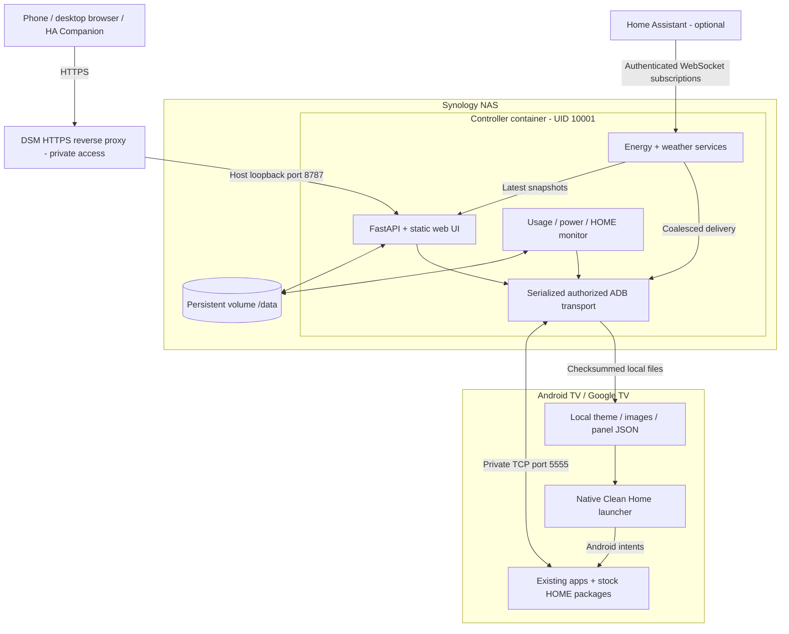
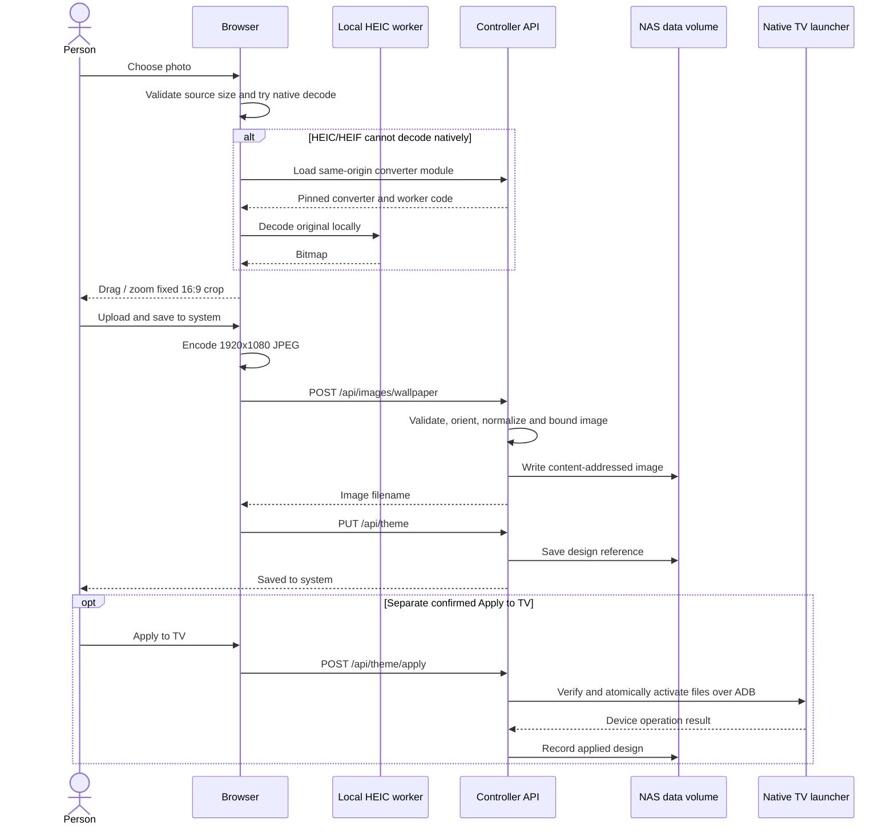
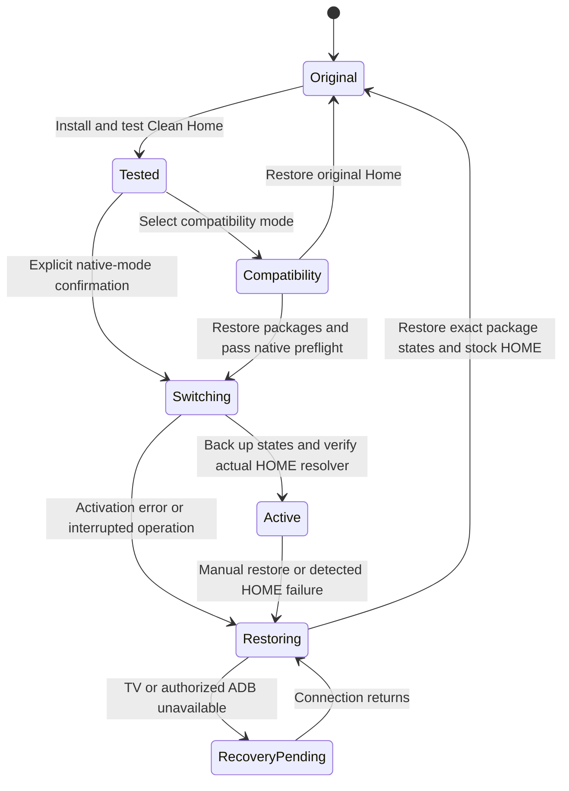

# Architecture and diagrams

[Documentation hub](README.md) | [Tech stack](TECH_STACK.md) | [Source build](BUILD.md)

## System overview

The system has two independently deployed applications: a small native Android
TV launcher and a Python controller on the NAS. The browser is the controller's
management UI, not the TV's Home screen. Home Assistant is an optional read-only
source, not a runtime requirement for launching apps or enforcing the timer.

There is no Docker socket mount and no privileged container. The container
uses a read-only root filesystem, a limited temporary filesystem and one
private writable data volume. The launcher has no `INTERNET` permission; it
reads files delivered through the controller's authorized ADB connection.

## Source map

Paths are relative to the repository root.

| Area | Entry points and responsibility |
|---|---|
| Android lifecycle and navigation | [MainActivity.java](../launcher/app/src/main/java/com/gathin/tvhome/MainActivity.java), [AppAdapter.java](../launcher/app/src/main/java/com/gathin/tvhome/AppAdapter.java), [GridNavigation.java](../launcher/app/src/main/java/com/gathin/tvhome/GridNavigation.java) |
| App discovery and layout | [AppCatalog.java](../launcher/app/src/main/java/com/gathin/tvhome/AppCatalog.java), [Config.java](../launcher/app/src/main/java/com/gathin/tvhome/Config.java), [ThemeStyle.java](../launcher/app/src/main/java/com/gathin/tvhome/ThemeStyle.java) |
| Native information cards | [LocalSnapshotView.java](../launcher/app/src/main/java/com/gathin/tvhome/LocalSnapshotView.java), [EnergyFlowView.java](../launcher/app/src/main/java/com/gathin/tvhome/EnergyFlowView.java), [WeatherView.java](../launcher/app/src/main/java/com/gathin/tvhome/WeatherView.java) |
| Compatibility Home | [HomeOverrideService.java](../launcher/app/src/main/java/com/gathin/tvhome/HomeOverrideService.java), [HomeOverridePolicy.java](../launcher/app/src/main/java/com/gathin/tvhome/HomeOverridePolicy.java) |
| HTTP startup and routes | [__main__.py](../controller/tvcontrol/__main__.py), [api.py](../controller/tvcontrol/api.py) |
| Models, sessions and persistence | [models.py](../controller/tvcontrol/models.py), [auth.py](../controller/tvcontrol/auth.py), [store.py](../controller/tvcontrol/store.py) |
| TV transport and preservation | [device.py](../controller/tvcontrol/device.py), [home.py](../controller/tvcontrol/home.py) |
| Accounting and enforcement | [monitor.py](../controller/tvcontrol/monitor.py) |
| Live data | [energy.py](../controller/tvcontrol/energy.py), [energy_topology.py](../controller/tvcontrol/energy_topology.py), [weather.py](../controller/tvcontrol/weather.py) |
| Browser UI and photos | [app.js](../controller/tvcontrol/static/app.js), [photo-tools.js](../controller/tvcontrol/static/photo-tools.js), [images.py](../controller/tvcontrol/images.py) |
| Offline development | [sandbox.py](../controller/tvcontrol/sandbox.py), [controller tests](../controller/tests/) |
| Packaging | [Dockerfile](../Dockerfile), [build-launcher.ps1](../scripts/build-launcher.ps1), [package-synology.py](../scripts/package-synology.py) |

The HTTP API exposes defined operations, not arbitrary shell execution. Models
reject unexpected fields and invalid app components. Interactive management
uses a browser session and a CSRF token on writes; it is not a public
unauthenticated automation API. Automatic OpenAPI/Swagger routes are disabled.

## State and persistence

| Location | Contents | Handling |
|---|---|---|
| NAS `/data/controller.sqlite3` and SQLite sidecars | Settings, captured inventory/baseline, daily usage, sessions, events and saved/applied theme references | Private; back up consistently with the service stopped or a proper SQLite backup |
| NAS `/data/assets/` | Normalized, content-addressed wallpapers and artwork | Private user media; never commit |
| NAS `/data/revisions/` | Theme configuration revisions | Back up with the same database and assets |
| NAS `/data/private-adb/` | This controller's ADB key pair | Secret identity; preserve both key files |
| NAS `/data/native-home-backup.json` | Original HOME component, exact managed package states and recovery phase | Required for guarded native-mode restoration |
| NAS `/data/home-override-backup.json` when present | Compatibility-service recovery information | Preserve with the rest of the private data |
| TV app external-files directory | Active config, images, `energy.json` and `weather.json` | Delivered atomically; not the source of NAS usage history |
| Developer sandbox directory | Fake device, manual clock and sandbox data | Kept separate by a runtime-mode marker |

The TV files live under
`/sdcard/Android/data/com.gathin.tvhome/files`. The TV's actual HOME preference
and package enabled states are Android state, not browser preferences.

Saved design and applied design are distinct. Uploading an image alone does
not mean a theme references it, and a successful NAS save does not prove a
successful TV transfer. The API records application only after the device
operation and preservation verification succeed.

## Photo selection, conversion and save

Choosing or cancelling a crop does not write to the TV. A failed upload/save
retains the pending crop for retry. The browser supports sources up to 40 MiB
and 60 million decoded pixels; the API separately limits image uploads to
8 MiB and 20 million decoded pixels. See [photo limits](TECH_STACK.md#resource-and-input-limits).
Conversion has no external service, and the original photo is not modified.

## Live energy and weather

The NAS authenticates to HA using a private token file. It subscribes over
WebSocket to selected energy entities and to the selected weather entity's
daily forecast. Automatic energy-card binding reads declarations; it does
not execute dashboard JavaScript.

Energy state is held as the latest in-memory snapshot, not an unbounded queue.
Changes are eligible for delivery once a second; identical energy values use
a ten-second TV heartbeat. High-priority TV control and power sampling take
precedence over telemetry delivery. The browser receives energy through
server-sent events. Native information views check local snapshots every
second while visible, on a lifecycle-bound worker rather than the UI thread.

HA-source freshness and TV-delivery freshness are separate: an energy source
is stale after 15 seconds without contact, while missing local delivery
expires the TV frame after 30 seconds. Weather uses a 15-minute freshness
window. Unknown, unavailable, not-installed and cloud-offline states are
meaningful; none silently becomes zero or simulated data.

## Guarded HOME lifecycle

Compatibility mode leaves Google TV enabled and redirects the stock HOME
window using an opt-in accessibility service. A brief Google TV frame can
therefore appear. Native mode disables only the two exact competing Google
HOME packages, leaves them installed and verifies the real Android resolver.
It refuses activation if the setup wizard owns saved Wi-Fi networks.

The NAS checks native HOME about every ten seconds. Recovery is triggered by
a missing/wrong resolver for at least 15 seconds, three Java/native crashes
within two minutes, or an Android-reported ANR. It restores the saved stock
states rather than silently reactivating Clean Home. It does not wake the TV
or replace active playback to show a recovered Home.

**Failback requires the NAS, debugging access and authorized reachable ADB.**
It is not an independent TV watchdog and cannot detect every rendering freeze.
See [installation safeguards](INSTALLATION.md#choose-a-home-mode) and
[recovery procedures](OPERATIONS.md#restore-original-home).

## Daily allowance and isolation

The monitor samples the selected app and awake state about every five
seconds, accounts observed intervals transactionally and splits days using
the configured IANA timezone. Menus and paused video count as foreground use.
Missing/offline observations are not invented as usage. The rule starts
disabled and standby requests are distinct from confirmed standby.

Sandbox mode replaces the real device transport entirely and binds only to
loopback. It uses a manual clock and a different data directory. A mode marker
rejects accidental reuse of real data. Its energy feed can still be live if
deliberately configured, but its TV operations never reach a real device.
