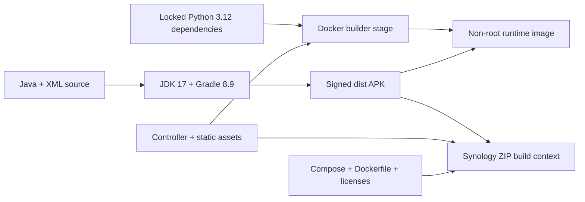

# Build and development

[Documentation hub](README.md) | [Stack](TECH_STACK.md) | [Contributing](../CONTRIBUTING.md)

Use a development checkout and isolated sandbox, not a running NAS project.
None of the test commands below require changing a real TV. Commands are
PowerShell unless a block is explicitly labeled Bash.

## Toolchain

- Git and GitHub repository access; GitHub CLI is convenient but not mandatory.
- Python 3.12+ for backend development.
- Node.js 24 is the documented photo-tool validation environment.
- JDK 17, Android SDK platform 34 and build-tools 34.0.0 for the APK only.
- Docker with Compose v2 for image testing/packaging, not for the Python sandbox.
- WebKit browser binaries for direct-mapping and photo browser tests.

Use the committed Gradle wrapper. Do not install a different global Gradle
to work around a wrapper error. Runtime/third-party sources and license
information are listed in [the stack reference](TECH_STACK.md).

## Clone and install backend dependencies

```powershell
gh repo clone zangkasi55/tcl-clean-launcher-with-backend
Set-Location .\tcl-clean-launcher-with-backend
python -m venv .venv
.\.venv\Scripts\python.exe -m pip install -e '.\controller[test]'
```

Use a local path outside a synced directory if possible. The Windows APK
helper already places its build/cache output outside OneDrive.

For macOS/Linux, use the equivalent environment commands:

```bash
python3 -m venv .venv
.venv/bin/python -m pip install -e './controller[test]'
.venv/bin/python -m tvcontrol --sandbox
```

These are development dependency installs. The release Docker build instead
installs [requirements.lock](../controller/requirements.lock) and then installs
the controller without re-resolving dependencies.

## Sandbox development

Run in a foreground terminal:

```powershell
$env:TVCONTROL_SANDBOX_DATA_DIR = Join-Path $env:LOCALAPPDATA 'TclHomeControl-dev'
$env:TVCONTROL_SANDBOX_PORT = '8790'
.\.venv\Scripts\python.exe -m tvcontrol --sandbox
```

Open `http://127.0.0.1:8790/`. Stop with Ctrl+C when finished. Sandbox binds
only to loopback, has no real-device transport, and uses separate persisted
fake data. Never point it at `/data` or another real controller directory.

Use **Sandbox controls** to set the foreground app, wake/sleep, disconnect,
advance time and skip days. Its clock is manual: waiting in the browser does
not consume simulated usage.

For self-contained demo energy, choose **Explicit simulated test data**
under the energy connection settings and save. Missing live HA authorization
does not automatically select fixtures. Do not configure production HA tokens
just to work on layout or photo handling.

### Deterministic allowance check

1. Enable the example 40-minute rule for the simulated YT app.
2. Set that app foreground, awake and online.
3. Advance 2,399 seconds: no standby.
4. Advance one more second: usage is 2,400 seconds and standby is confirmed.
5. Wake the exhausted app: it returns to standby.
6. Choose Next day and wake it: a fresh allowance is available.

Day jumps skip unobserved time; normal Advance steps account for it.

## Backend checks

From the repository root:

```powershell
.\.venv\Scripts\python.exe -m pytest controller\tests -q -p no:cacheprovider
.\.venv\Scripts\python.exe -m ruff check controller
node --check controller\tvcontrol\static\app.js
node --check controller\tvcontrol\static\photo-tools.js
```

For a focused photo/authentication change:

```powershell
.\.venv\Scripts\python.exe -m pytest controller\tests\test_images.py controller\tests\test_api.py controller\tests\test_passwordless.py controller\tests\test_management_access.py -q
```

Tests use fake devices and temporary stores. Do not replace them with calls to
the production portal. Run the smallest relevant set during development and
the applicable full component suite before a PR.

## Photo tools and WebKit tests

The vendored decoder is already committed and packaged. Node dependencies
are needed only for development, vendoring and browser tests:

```powershell
npm --prefix .\controller ci --ignore-scripts
npm --prefix .\controller run test:photos
```

To deliberately reproduce the pinned unmodified converter and notices:

```powershell
npm --prefix .\controller run vendor:photos
```

Review asset/version/license changes when upgrading a converter. Do not
minify or patch the vendored module ad hoc or remove its notices.

For browser regression, use a **separate terminal** and fresh sandbox:

```powershell
$env:TVCONTROL_SANDBOX_DATA_DIR = Join-Path $env:LOCALAPPDATA 'TclHomeControl-photo-tests'
$env:TVCONTROL_SANDBOX_PORT = '18796'
.\.venv\Scripts\python.exe -m tvcontrol --sandbox
```

Then, in another terminal from the repository root:

```powershell
npm --prefix .\controller exec -- playwright-core install webkit
$env:TCL_PHOTO_TEST_URL = 'http://127.0.0.1:18796'
$env:TCL_HA_TEST_URL = 'http://127.0.0.1:18796'
node --test --test-concurrency=1 .\controller\tests\ha-cards.webkit.mjs .\controller\tests\photo-upload.webkit.mjs .\controller\tests\ha-embedding.webkit.mjs
```

The browser runners refuse writes unless status explicitly reports
`sandbox.real_device_access === false`. It tests repeated saving/reloading,
EXIF rotation, large source preparation, actual HEIC/HEIF fallback decoding,
crop behavior, failure/retry and mobile orientation. The fixtures are original
synthetic patterns, not personal photos. Direct-mapping tests also verify
saved-only transfer, visible transport errors, unsaved edits surviving polling
and unrelated saves, and separation from backend/theme/HOME/installation.
Embedding tests additionally cover lower-form scroll reachability in mobile
WebKit, all three sections, portrait crop access, HA polling/ingress renewal,
and visible connection errors with retry. WebKit's mobile automation does not
support a native wheel/swipe; these checks do not claim physical iPhone touch
acceptance. Verify a real touch drag separately. Run the suites sequentially
when they share a sandbox. Stop it when done.

The npm scripts use portable paths. On macOS/Linux, equivalent direct entry
points from `controller/` after `npm ci` are:

```bash
node --test tests/photo-tools.test.mjs
npx playwright-core install webkit
TCL_HA_TEST_URL=http://127.0.0.1:18796 TCL_PHOTO_TEST_URL=http://127.0.0.1:18796 node --test --test-concurrency=1 tests/ha-cards.webkit.mjs tests/photo-upload.webkit.mjs tests/ha-embedding.webkit.mjs
node ../scripts/vendor-photo-converter.mjs
```

The separate sandbox server must still be running at that address.

## Home Assistant ingress app tests

From the repository root, with the controller development environment:

```powershell
.\.venv\Scripts\python.exe -m pip install -r .\home-assistant\tcl_control\requirements.txt
.\.venv\Scripts\python.exe -m unittest discover -s .\home-assistant\tcl_control -p test_proxy.py -v
.\.venv\Scripts\python.exe -m ruff check .\home-assistant\tcl_control
node --check .\controller\home-assistant\tcl-control-card.js
```

These tests use an isolated synthetic upstream, never the NAS or HA. They
verify ingress-peer and per-user authorization, exact HTTPS configuration,
unchanged Origin/CSRF forwarding, credential filtering, cookie path/security,
streaming events, restricted redirects and bounded uploads with explicit
413 errors. The normal 8 MiB prepared-image size still fits through the app.
See [installation](../home-assistant/tcl_control/DOCS.md) for actual Supervisor
deployment, which requires no exposed host port.

## Native launcher: contributor build

Set `JAVA_HOME` to your JDK 17 directory and `ANDROID_HOME` to your SDK
directory. Install SDK platform 34 and build-tools 34.0.0 using your SDK
manager. Check the toolchain before building:

```powershell
& "$env:JAVA_HOME\bin\java.exe" -version
Test-Path -LiteralPath "$env:ANDROID_HOME\platforms\android-34\android.jar"
Push-Location .\launcher
.\gradlew.bat --no-daemon testReleaseUnitTest lintRelease assembleRelease
Pop-Location
```

The normal contributor build uses local debug signing for compatibility with
the upstream workflow. Its output is
`launcher\app\build\outputs\apk\release\app-release.apk`.
On macOS/Linux, the equivalent command from `launcher/` is:

```bash
./gradlew --no-daemon testReleaseUnitTest lintRelease assembleRelease
```

Do not use `build-and-install` scripts merely to run tests: those scripts can
change a real TV. Do not install a differently signed build over an existing
production launcher. It cannot update that installation in place.

## Native launcher: private release signing

On Windows:

```powershell
.\scripts\build-launcher.ps1
```

This runs native tests, Android lint and the release build using bounded
workers and external build/cache directories. It creates/reuses a private
signing identity, verifies the candidate signature and requires **1-409,600
bytes inclusive**, positive executed tests and zero failures/errors/skips.
An existing accepted APK is replaced atomically only after these gates and
signer continuity checks pass. It recognizes portable tools under
`%LOCALAPPDATA%\TclTvBuild`. Explicitly skipping tests is not a tested release.

The synthetic acceptance regressions use no real signing identity:

```powershell
Import-Module Pester -RequiredVersion 3.4.0 -Force
$result = Invoke-Pester .\scripts\tests\BuildLauncher.Tests.ps1 -PassThru
if ($result.TotalCount -eq 0 -or $result.FailedCount -ne 0 -or $result.SkippedCount -ne 0) {
    throw 'Release acceptance regressions did not pass completely.'
}
```

Private signing files live under `%LOCALAPPDATA%\TclTvBuild\signing`, outside
the repository. **Back up both the keystore and password file securely.**
Losing either prevents future signed in-place updates. Never commit them,
attach them to an issue or include them in a release ZIP.

The released APK was signed with the maintainer's identity. A new contributor
checkout does not contain that key. A contributor must use a separate test
TV/emulator or a deliberately managed installation for their own signature;
do not uninstall a user's production launcher to bypass a signature mismatch.

## Build the container

The Dockerfile needs `dist\tvhome-release.apk`. For current 2.6.26 source,
build its matching native APK as above:

```powershell
.\scripts\build-launcher.ps1
docker compose build
```

The existing v2.6.23 release APK is older and lacks direct HA. To use that
release, use its complete matching ZIP/build context and verify the
[download checksums](INSTALLATION.md#1-download-and-verify-a-release), rather
than mixing components. Recompiling with a new signing key cannot update an
existing differently signed installation in place.



There is no published Docker registry image in this workflow. `docker compose
build` builds locally. Do not run production `docker compose up` as a harmless
sandbox command: real mode can connect to a TV using its configured address.
Use `--sandbox` for normal development.

## Runtime lock and Synology package

For ordinary source changes, preserve the committed runtime lock. Only
regenerate it as part of a deliberate dependency update:

```powershell
.\.venv\Scripts\python.exe scripts\lock-runtime.py
```

That script inspects installed distributions while evaluating Linux
CPython 3.12 markers. It is not a fresh cross-platform dependency solver.
All selected runtime distributions must be installed and compatible;
review the resulting versions and validate the Python 3.12 image build.

Once the release APK and static assets are ready:

```powershell
.\.venv\Scripts\python.exe scripts\package-synology.py
```

It produces `dist\tcl-home-control-synology.zip`, checks CRC integrity and
reports SHA256. It includes only the selected deployment inputs, not the
entire repository, runtime volume or private signing identity.

For an actual release, independently scan the archive for secrets, verify
its embedded APK and source match the intended revision, generate checksums
and round-trip-download the uploaded assets. An archive's filename safety
checks do not replace a content scan.

## Other checks and CI coverage

The inherited lists/tools/docs suite is:

```powershell
python -m unittest discover -s tests -v
```

It expects the upstream tools dependencies. Follow
[tools/requirements.txt](../tools/requirements.txt) if they are missing.
For README/example-table-only changes, the targeted check is:

```powershell
$env:CLEANYOURTV_STRICT = '1'
python -m unittest discover -s tests -p test_examples.py -v
```

The GitHub workflow runs lists/tools/docs, native tests/lint/build and the
exact **1-409,600-byte** APK gate. Separate jobs run controller pytest/Ruff,
Node photo tests, sequential isolated WebKit mapping/photo tests and Windows
synthetic release acceptance. State local results in PRs as well. None of
these jobs establishes physical TV, manufacturer-cloud, remote or iPhone
acceptance.

The optional [performance benchmark](../scripts/benchmark-performance.py)
uses offline work counts, not claimed physical-TV frame rates:

```powershell
.\.venv\Scripts\python.exe scripts\benchmark-performance.py --assert-optimized
```

## Release checklist

- [ ] Relevant backend, Node, WebKit and native suites pass.
- [ ] Direct-mode TLS/Keystore, real card freshness/lifecycle, backend independence
      and explicit rollback are verified on the intended TV before hardware claims.
- [ ] Firmware/iPhone claims distinguish emulation from physical tests.
- [ ] UI/Compose release versions and native version are intentionally chosen.
- [ ] Signing identity is preserved; private keys never enter source/assets.
- [ ] Decoder/font/original license notices are packaged.
- [ ] ZIP/APK hashes are recorded and uploaded assets are re-downloaded.
- [ ] No personal photos, credentials, runtime data or device dumps are included.
- [ ] Upgrade/rollback instructions preserve the private data volume.
