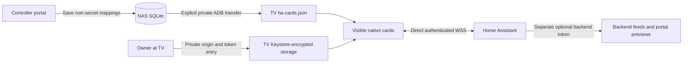
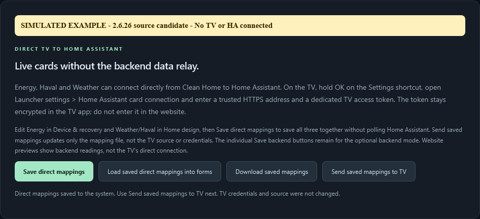

# Direct Home Assistant cards

[Documentation hub](README.md) | [Architecture](ARCHITECTURE.md) | [Build](BUILD.md) | [Recovery](OPERATIONS.md)

Energy Distribution, Haval battery/charging and Weather can read Home Assistant
directly from the native TV launcher. The NAS continues managing the launcher,
wallpaper, app allowance and HOME recovery; it is no longer the readings relay
when **direct mode** is selected.

## Status and prerequisites

This is **2.6.26 source**, with native **2.6.26-tcl / version code 20**.
Automated native/controller tests and isolated NAS validation are not proof
of a completed TV installation. Final physical-TV installation, private token
provisioning, Android TLS/Keystore acceptance and physical remote-button checks
remain pending. No new stable packaged release is implied.

The existing **v2.6.23** download contains native **2.6.18-tcl** and cannot run
these direct connections. Build the matching source components; do not combine
the old downloaded APK with the new controller and call it a direct-HA release.

You need:

- A matching current launcher and controller, installed during an approved
  maintenance window without uninstalling or clearing app data.
- A trusted HA **HTTPS origin** reachable by the TV, including correct DNS,
  certificate chain, TV clock and WebSocket routing.
- A dedicated non-admin HA account/token entered privately **on the TV**.
- Exact entity mappings, or one supported declared Energy Distribution card.
- Authorized private ADB only for management/mapping transfer, not for the
  direct HA readings themselves.

The application uses read/subscription commands only. An ordinary HA token
still carries its account permissions; client-side restrictions do **not**
make that token server-side read-only.

## Data flow and credential boundary



The TV token is never sent to the portal, mappings, theme, logs or exported
baseline. It is encrypted using Android Keystore AES-256-GCM, with a fresh
12-byte IV and the normalized origin as authenticated associated data.
Private preferences are named `ha_connection_v1`, with key alias
`tvhome.ha.v1`. The settings activity is non-exported, landscape and
screen-capture protected; it does not prefill or restore token text.

The NAS token, if configured for previews/backend mode, remains separate.
Do not copy it into the TV or retrieve it merely to avoid provisioning a
dedicated TV identity.

## 1. Prepare and save mappings

Open the controller portal:

1. In **Device & recovery**, configure Energy Distribution. Choose a supported
   dashboard URL path and view, or explicit instantaneous W/kW sensor mappings.
   Do not substitute daily kWh totals.
2. In **Home design**, enable Weather and choose an exact `weather.*` entity
   supporting daily forecasts.
3. In **Home design**, enable Haval and select an exact `sensor.*` battery
   percentage entity and `binary_sensor.*` charging entity.
4. Select the real **Home Assistant WebSocket** transport for all three
   mappings, including disabled card sections. Simulation is not transferable
   as direct-TV configuration.
5. Choose **Save direct mappings** and wait for saved confirmation.
6. With the intended TV online and authorized, choose **Send saved mappings
   to TV**. Confirm success rather than assuming an HTTP-healthy portal means
   the TV received it.

Unsaved, invalid, simulated, busy or offline transfers are explicitly refused.
Saving direct mappings does not overwrite backend feed configuration.
Sending maps transfers **no credentials**, does not select direct mode,
install an APK, change HOME or navigate the TV.



*2.6.26 sandbox example: mappings are saved, but no TV or HA is connected and
no token was entered. The success text confirms that saving did not change
TV credentials or source. [Capture provenance](screenshots/README.md).*

### Credential-free document example

This minimal example uses generic entity names; the portal validates and
serializes the full schema. All three sections are required, with no extra
fields, strict UTF-8 and a maximum encoded size of 16,384 bytes:

```json
{
  "schema_version": 1,
  "energy": {
    "enabled": true,
    "transport": "websocket",
    "topology_dashboard": "energy-dashboard",
    "topology_view": "Home"
  },
  "weather": {
    "enabled": true,
    "transport": "websocket",
    "entity_id": "weather.home"
  },
  "vehicle": {
    "enabled": true,
    "transport": "websocket",
    "battery_soc_entity": "sensor.vehicle_battery",
    "charging_entity": "binary_sensor.vehicle_charging"
  }
}
```

Transfers use a pending file, byte/hash verification and atomic rename.
The document contains no URL/token and is stored separately from theme and
backend panel files. Treat actual household mappings as private configuration.

## 2. Select direct mode on the TV

1. Open Clean Home when doing so will not interrupt someone else's playback.
2. **Hold OK on the Settings shortcut**, open **Launcher settings**, then
   **Home Assistant card connection**.
3. Enter your trusted origin, for example `https://ha.example.com`.
   Do not include `/api`, a dashboard path, credentials, query or fragment.
4. Enter the dedicated TV token privately, without whitespace.
5. Choose **Save on TV and use direct HA** and check the result.
6. Return Home and inspect all enabled cards. A save/source-selection message
   is not proof that HA authenticated or that the entities are live.

The physical gear button is a route to **TV system settings**, not this
private launcher connection form. Firmware-dependent key handling must still
be tested on the actual remote.

## 3. Verify the exact outcome

The lower row is **Energy 30% / Haval 10% / Weather 30% of full-screen width**,
not percentages of the remaining row. Cards remain read-only and do not trap
D-pad focus. Haval shows percentage and **Charging / Not charging**, never
vehicle controls.

- Compare Energy with HA using the approved signs and quality flags. The
  existing ESS-Link preset intentionally reverses the grid import/export
  entity names. Do not "correct" those names without validating the readings.
- Confirm Haval SOC is 0-100% with `%` units and charging is exactly HA `on`
  or `off`. Unknown charging is not assumed off. HA contact freshness does
  not guarantee current manufacturer/cloud telemetry.
- Confirm Weather units and one to three chronological timezone-aware daily
  forecasts. A missing low remains absent, not an invented zero.
- Check leave/return to Home, standby/wake, restart and network reconnect.
  Old-session callbacks must not overwrite a newly selected source/mapping.
- During a safe maintenance window, verify direct cards independently of
  NAS feed delivery. Stopping the NAS also stops allowance enforcement and
  automatic HOME failback; do not treat that as a harmless casual test.
- Test rollback separately. Browser previews remain **backend** readings,
  not an authenticated status display of the direct TV sessions.

## Lifecycle and freshness contracts

One process-wide serial worker coordinates **one connection per visible
enabled card type**. There is not one global socket for every card.
Cards must be attached, shown, window-visible and foreground; the last hidden
owner closes that card's session, and returning reconnects.

Connections use WSS at the fixed `/api/websocket` path, platform TLS/hostname
verification, a 1 MiB frame bound and 10-second protocol deadlines.
Reconnect delays are 1, 2, 4, 8, 16, 32 and then at most 60 seconds; only
actual live data resets backoff. Authentication/configuration/subscription
errors are explicit, not endless success-shaped retries.

Energy observations expire after 15 seconds; Weather and Haval after
900 seconds. Keepalive pongs do not refresh data. Old or more-than-five-second
future observations are stale. Invalid/missing data is never silently zero,
simulated, or replaced with a backend snapshot in direct mode.

## Explicit rollback and token removal

In the same TV connection screen:

- **Use backend readings (explicit rollback)** selects the legacy file source
  and retains the encrypted TV connection for a later deliberate return.
  Backend feeds still need their own valid NAS authorization and mappings.
- **Forget TV token and use backend readings** removes the TV key/connection
  and selects backend mode. Also revoke the token in HA if it is no longer
  needed. Deleting the TV copy alone does not revoke HA authorization.

Failures are reported. If secure key deletion fails, preferences are retained
rather than falsely reporting a completed forget. Neither action clears
streaming-app data, wallpaper or the saved HOME recovery baseline.

## Troubleshooting

| Symptom | Check and safe next action |
|---|---|
| Mapping send refused | Save valid WebSocket mappings first; verify intended TV, ADB authorization and busy status |
| Direct selected but cards unavailable | Verify actual matching APK, sent mapping, TV DNS/time/trusted certificate and HA route |
| Authentication rejected | Correct/reissue the dedicated TV token privately, then save the connection again |
| Dashboard/subscription error | Use one supported declared card or valid explicit sensors; choose a forecast-capable weather entity |
| Portal preview live, TV stale | These are different sources; diagnose the TV's HA connection instead of declaring success from the portal |
| HA unavailable in direct mode | Restore HA/network or deliberately select backend mode; automatic fallback is intentionally absent |
| Charging unknown | Repair the binary sensor; do not substitute false |
| Settings gear does nothing | Use the on-screen shortcut, then check the owned remote-key service and physical remote during maintenance |

Do not disable TLS checks, expose ADB, paste tokens into diagnostics or clear
app data to work around setup errors. For contributor checks, use
[the isolated test workflow](BUILD.md#photo-tools-and-webkit-tests).
