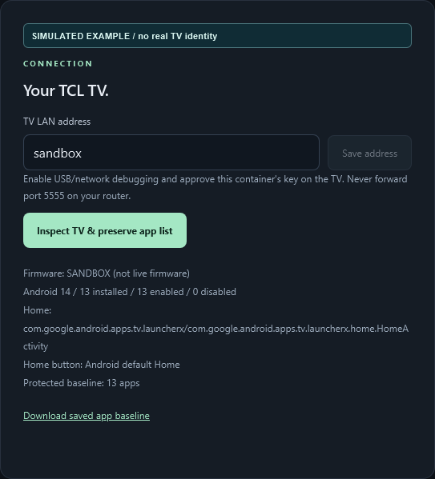
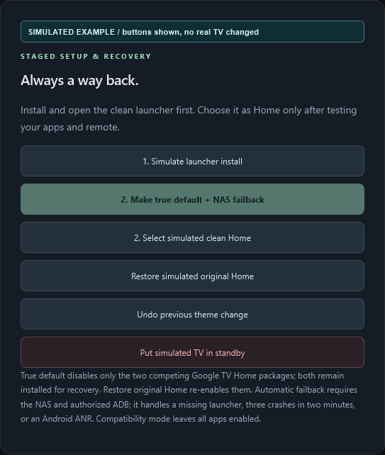

# Installation and first run

[Documentation hub](README.md) | [Configuration](CONFIGURATION.md) | [Recovery](OPERATIONS.md)

This is a staged installation: **deploy the controller, pair the TV, capture a
baseline, install/test the launcher, then choose Home mode**. Do not start by
disabling the stock launcher. Existing streaming apps are not bundled, replaced
or logged out.

## Requirements

| Requirement | Notes |
|---|---|
| Compatible TV | Android TV / Google TV, Android 8+ for the APK. Tested native-default behavior is TCL/firmware-specific, not universal. |
| TV debugging | Authorized private-network ADB on TCP 5555. The controller does not implement the newer wireless-pairing-code flow. |
| NAS | A Synology model with Container Manager support and outbound access to download build dependencies. ARM/other Docker hosts require their own validation. |
| Network | NAS must reach the TV's private IPv4 address. Reserve the TV's DHCP address if possible. Never forward ADB through the internet. |
| HTTPS | A trusted certificate, a hostname the client can resolve, and an HTTPS reverse proxy to the controller. |
| Browser | Modern desktop browser or iPhone Safari/HA Companion. Direct HTTPS access is the simplest first test. |
| GitHub access | This repository is private. Sign in with an account invited by the owner before downloading or cloning. |
| Optional HA | Reachable Home Assistant and a dedicated authorized token, stored only on the backend. |

No root, firmware flashing, factory reset or Android SDK is required when
using the release packages. A native-default preflight needs Android 11+
diagnostics and the exact supported Google HOME packages; an APK API level
alone does not establish compatibility.

## 1. Download and verify a release

Open [Releases](https://github.com/zangkasi55/tcl-clean-launcher-with-backend/releases/latest)
and download:

- `tcl-home-control-synology.zip`: NAS build context, controller and signed APK.
- `tvhome-release.apk`: the same signed APK as a standalone download.
- `SHA256SUMS.txt`: expected hashes for both files.

Alternatively, from a local PowerShell terminal with the GitHub CLI:

```powershell
gh auth login
New-Item -ItemType Directory -Path .\downloads -Force | Out-Null
gh release download v2.6.23 --repo zangkasi55/tcl-clean-launcher-with-backend --dir .\downloads
$sums = Get-Content -LiteralPath .\downloads\SHA256SUMS.txt
foreach ($name in @('tvhome-release.apk', 'tcl-home-control-synology.zip')) {
    $line = @($sums | Where-Object { $_.EndsWith("  $name") })
    if ($line.Count -ne 1) { throw "Missing or duplicate checksum: $name" }
    $expected = $line[0].Substring(0, 64)
    $actual = (Get-FileHash -LiteralPath (Join-Path .\downloads $name) -Algorithm SHA256).Hash
    if ($actual -ine $expected) { throw "Checksum mismatch: $name" }
}
Expand-Archive -LiteralPath .\downloads\tcl-home-control-synology.zip -DestinationPath .\tcl-home-control
```

Stop on a mismatch; do not install or build from that download. Checksums
establish byte integrity against the release, not trust in an unknown source.
The release ZIP is not a DSM `.spk` and is not a prebuilt container image.

## 2. Prepare a dedicated NAS project folder

1. Upload the extracted build context to a new folder, for example
   `/volume1/docker/tcl-home-control`.
2. Keep `Dockerfile`, `docker-compose.yaml`, `controller/`, `dist/` and license
   files in their extracted relative locations. Do not flatten the folder.
3. Do not overwrite an HA project or reuse another service's data volume.
4. Keep any local `.env`, HA token file, exported baseline and backup private.

For an **existing** installation, follow [the update procedure](OPERATIONS.md#update-the-controller)
instead of these fresh-install steps.

## 3. Configure your own address and access

Create a local `.env` beside `docker-compose.yaml`, substituting your values:

```dotenv
TVCONTROL_TV_HOST=192.168.1.50
TVCONTROL_PUBLIC_ORIGIN=https://tv.example.com
```

`192.168.1.50` and `example.com` are examples, not discovered device settings.
Use a hostname/certificate you control and private DNS/routing your phone and
NAS can actually reach. Do not upload the `.env` to GitHub.

**Important:** the supplied Compose file explicitly sets
`TVCONTROL_REQUIRE_LOGIN: "false"`. For a first installation or shared LAN,
edit that existing field to `"true"`:

```yaml
services:
  tvcontrol:
    environment:
      TVCONTROL_REQUIRE_LOGIN: "true"
```

This is a fragment showing the field to edit, not a replacement Compose file.
Keep all other build, port, volume and hardening settings. Setting
`TVCONTROL_REQUIRE_LOGIN` in `.env` alone does not override a literal value
already written in Compose. If you deliberately keep passwordless mode, every
allowed network client can obtain a session; restrict access accordingly.

The bundled `ess_link` HA profile is installation-specific. If you do not use
that mapping, set its existing `TVCONTROL_HA_PROFILE` field to `""` and
configure your own sensors later. HA is not required for the launcher.

## 4. Create the Container Manager project

1. In DSM, open **Container Manager > Project > Create**.
2. Use the project name `tcl-home-control` and your dedicated folder.
3. Select the existing `docker-compose.yaml` and review the configuration.
4. Build and start the project. The NAS installs locked Python dependencies;
   it does not compile Android.
5. Wait for a running, healthy container. Inspect startup errors rather than
   repeatedly recreating the project or deleting the volume.

The supplied port mapping is `127.0.0.1:8787:8787`. A browser on another device
cannot open the NAS LAN IP on that port directly; this is intentional.
The named `tvcontrol-data` volume stores private settings, usage, media and
ADB identity. With the example project name, Compose normally prefixes it as
`tcl-home-control_tvcontrol-data`; inspect the actual mount before backing up.

## 5. Add a dedicated HTTPS reverse proxy

In DSM's reverse-proxy settings, create a **new** rule:

| Field | Example |
|---|---|
| Source | HTTPS, `tv.example.com`, port 443 |
| Certificate | Trusted certificate for that hostname |
| Destination | HTTP, `127.0.0.1`, port 8787 |
| Access | Trusted LAN or authorized VPN only |

Do not replace an existing DSM or HA rule. Do not expose raw port 8787 or
ADB 5555 publicly. A reverse proxy must preserve the public host/protocol and
allow the energy event stream to stay open. Set the controller's public
origin to the exact HTTPS scheme, hostname and port, without a path.

Visit `https://tv.example.com/healthz`. Expected service response:

```json
{"service": "ok", "monitor": "online"}
```

Before TV pairing, `monitor` can report another state while HTTP remains 200.
This endpoint proves service health, **not** authorized TV access or successful
standby. Open the portal and check the separate TV connection status.

If login is enabled, retrieve the generated initial password privately from
`/data/initial-admin-password.txt` through the container terminal or your secure
NAS administration channel. Do not paste it into an issue, documentation or
screenshot. No generated password file is needed in passwordless mode.

## 6. Authorize the controller on the TV

1. On the TV, enable Developer options and the supported USB/network debugging
   controls. The exact Settings labels vary by firmware.
2. Keep the TV awake and on screen during pairing.
3. In **Device & recovery**, confirm the TV's current private IPv4 address.
4. Choose **Inspect TV & preserve app list**.
5. Accept the TV's debugging authorization prompt for **this controller**.
   Authorizing a PC previously does not authorize the container's separate key.
6. Inspect again if the first attempt timed out during the prompt.
7. Download the saved app baseline and store it privately.

The baseline records original Home and installed/enabled/disabled package sets.
If inspection reports an unexpected package-state change, investigate it; do
not edit the baseline simply to make the check pass.



*Simulated connection example: **Inspect TV & preserve app list** captures the
baseline; **Download saved app baseline** exports it. The address `sandbox`,
firmware label and package counts are fake. Enter your own private TV IPv4
address in production; this image is not pairing evidence for a real TV.*

## 7. Install and test before changing Home

Choose **1. Install & open clean launcher** and confirm. Installation opens
Clean Home but does not deliberately change the existing default Home.

Verify:

- Your usual apps still exist and retain their sign-ins.
- Favorites launch correctly; choose installed apps if the example defaults
  do not exist on your TV.
- Down opens All apps; Up/Back return as described in the [user guide](USER_GUIDE.md).
- Inputs, Wi-Fi and Settings remain accessible.
- Your remote can reach stock Settings/recovery.
- Saved and applied design states are clearly distinguished.

## Choose a Home mode

### Keep stock Home while testing

Open Clean Home manually. This changes the least and is the safe initial
choice while evaluating a new TV/firmware.

### Compatibility Home

**Use compatibility Home (keep Google TV enabled)** keeps existing packages
enabled. The opt-in service redirects the Google TV Home window. A brief
stock-launcher frame can appear, and some TCL firmware needs NAS-assisted
accessibility recovery after a full boot.

### True default plus NAS failback

Use **2. Make true default + NAS failback** only after reviewing the warnings
and validating your recovery route. It is not a universal Android launcher
switch.

- It requires the exact recorded stock Home and supported package states.
- It refuses activation if the setup wizard owns saved Wi-Fi profiles, because
  disabling that package can remove those networks.
- It saves a recovery backup before changing only
  `com.google.android.apps.tv.launcherx` and
  `com.google.android.tungsten.setupwraith`.
- Both packages stay installed. Actual Android HOME resolution is verified;
  a successful role-setting command alone is not accepted as proof.
- NAS/ADB recovery must remain reachable. Disabling debugging prevents portal
  TV changes, timer enforcement and automatic failback, even though the native
  Home preference and already-delivered wallpaper can remain on the TV.

Use **Restore original Home** to reverse the managed package/role changes.
Do not uninstall stock Home or run the generic debloat installer as part of
this setup.



*Simulated control reference, not a completed native-default installation.
Install/test is the first stage; a real supported TV can then use the separately
confirmed true-default action. That action is disabled in the sandbox because
it cannot validate real firmware. Stock-Home restore and standby affect a real
TV in production, so do not use them casually during playback.*

## First-run acceptance checklist

- [ ] Controller runs healthy and opens through private HTTPS.
- [ ] Real TV is online/authorized; this is not merely a healthy web service.
- [ ] Original package baseline is exported privately.
- [ ] Existing apps, inputs, sign-ins and Settings are preserved.
- [ ] Launcher, D-pad and app return behavior are tested.
- [ ] Home mode is deliberately chosen; recovery is understood and reachable.
- [ ] Wallpaper is saved, reloaded and applied as separate checks.
- [ ] Daily allowance stays disabled until you deliberately test/enable it.
- [ ] HA mappings, if used, match your own sensors and display honest freshness.
- [ ] Private data-volume and signing-key backup plans are in place.

Continue with [everyday use](USER_GUIDE.md) and [operations](OPERATIONS.md).
