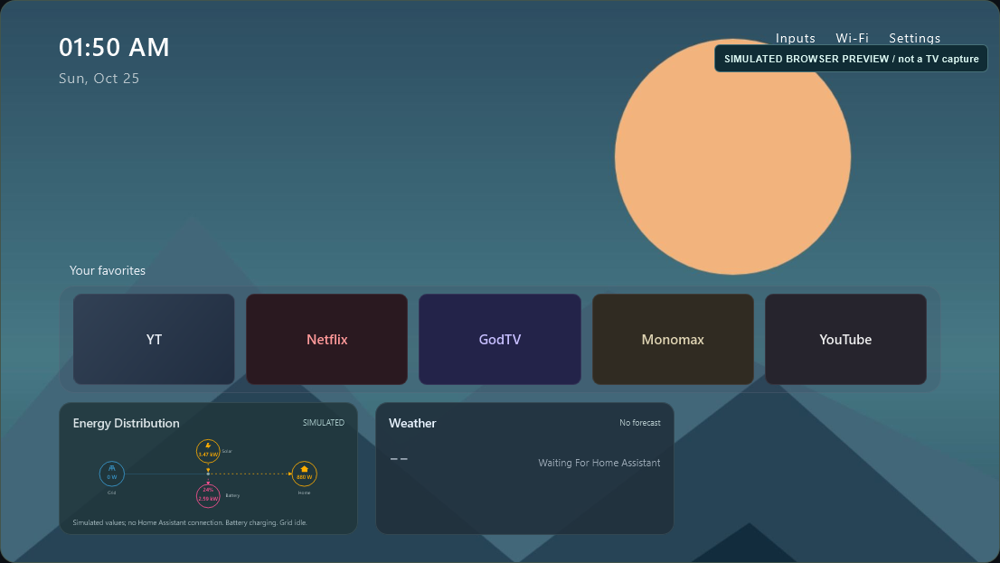
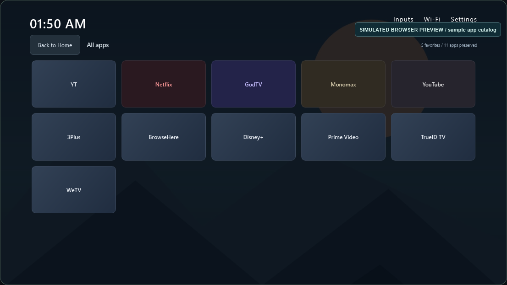
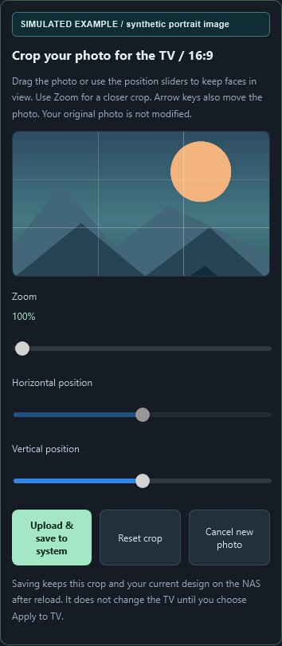
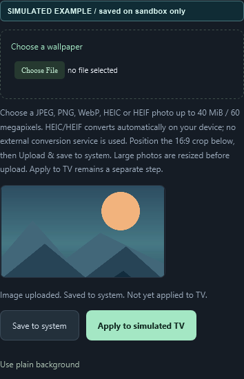
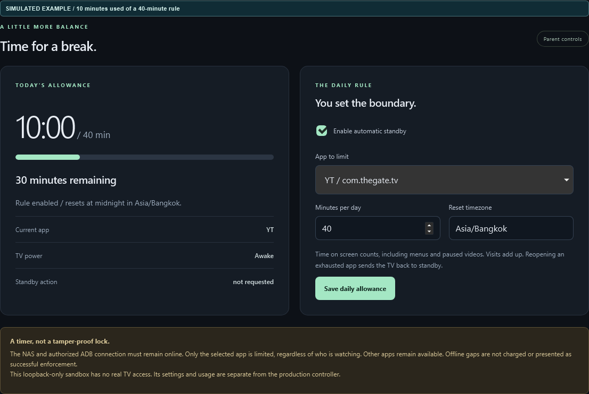

# User guide

[Documentation hub](README.md) | [Install first](INSTALLATION.md) | [Troubleshooting](OPERATIONS.md#troubleshooting)

## What runs where

**Clean Home** is the native screen on the TV. **TCL Home Control** is the
website on your phone or computer. Its layout preview is illustrative, not
a continuous live TV screenshot. Applying a saved design updates the TV;
editing the preview alone does not.

The portal has three main sections: **Home design**, **Daily allowance** and
**Device & recovery**. Connection and recovery warnings are separate from the
website's availability, so read them before sending TV commands.

**About the pictures:** every screen below comes from an isolated simulator,
with an original synthetic wallpaper and sample data. Wide-screen pictures
are browser previews, not native Android TV screenshots. Mobile pictures use
a WebKit iPhone-sized viewport, not a physical-device certification. See
[sample provenance](screenshots/README.md).

## TV remote navigation

| Action | Behavior |
|---|---|
| Left / Right on favorites | Move through the favorites dock |
| OK / Select | Open the focused app |
| Down from favorites | Open the separate All apps screen |
| Up from the first All apps row | Return Home |
| Back while in All apps | Return Home |
| Home button | Return to Clean Home if your chosen HOME mode is working; focus the first favorite |
| Return from an app | Restore that page's app focus where applicable |

Energy/weather cards are read-only and do not trap D-pad focus. The Home
photo stays mostly clear above the lower favorites/information area.
Firmware-specific Inputs, Settings and accessibility behavior should be
checked on the real TV rather than inferred from a browser preview.

*Example 1: Home leaves the upper background clear. Energy is explicitly
simulated; the weather card has no forecast. These are not live household values.*

## Home design

### Favorites and full catalog

Choose favorites from the inspected installed-app catalog and arrange their
order. The controller permits 1-7 distinct favorites and 4-7 columns; the
chosen column count must fit all favorites. Distinct activity aliases can
appear separately in the full catalog. Changing this layout does not
uninstall an app, clear its data or change its streaming account.

The supplied favorites are examples, not bundled apps. Pick replacements
that are actually installed if your TV does not have them.

*Example 2: All apps has its own page. The preview's Back to Home button is a
browser control; use Up from the first row or Back on the TV remote.*

### Choose and crop a wallpaper

1. Open **Home design** and choose a wallpaper.
2. Select JPEG, PNG, WebP, HEIC or HEIF.
3. Wait for the 16:9 crop to open. HEIC/HEIF conversion is automatic.
4. Drag with a finger/mouse and use zoom or the horizontal/vertical sliders.
   Arrow keys also move the selection.
5. Use **Reset crop** to recenter or **Cancel new photo** to discard it.
6. Tap **Upload & save to system** and wait for the saved confirmation.
7. Reload the page if you want to verify persistence before touching the TV.
8. Tap **Apply to TV** separately and confirm when ready.

*Example 3: a generated portrait PNG is cropped to 16:9. Keep the important
subject inside the grid, then tap the green **Upload & save to system** button.
HEIC/HEIF uses the same crop controls after automatic local conversion.*

Conversion is local to your device. If native HEIC decoding fails, a decoder
served by your controller uses a local worker. No external conversion service
receives the source photo, and the original is not changed. Only a prepared
crop is uploaded.

Supported sources are at most 40 MiB and 60 megapixels. The crop becomes a
1920x1080 JPEG before upload, then the server normalizes it further. A phone
can still run out of memory on a very large source; export a smaller JPEG if
it cannot prepare that photo.

Selecting a photo alone is not a save. An upload/save error keeps the crop
open for retry and shows an error instead of a false success. The same file
can be selected again. The regular **Save to system** and **Apply to TV**
actions also include a pending crop.

### Understand the three states

| State / action | NAS persisted? | TV changed? |
|---|---|---|
| Choose photo / adjust crop / edit controls | Not yet | No |
| Upload & save to system / Save to system | Yes, after success | No |
| Apply to TV | Saves first, then attempts device application | Yes, only if device transfer/application succeeds |

*Example 4: after saving and reloading, the thumbnail and **Saved to system.
Not yet applied to TV** message remain. The sandbox labels its separate
action **Apply to simulated TV**; a real controller says **Apply to TV**.
An empty file-picker filename after reload does not mean the saved image was lost.*

A saved image thumbnail after reload confirms NAS persistence, not TV delivery.
If Apply fails, read the error and device connection status. Do not keep
pressing Home or reboot the TV as an upload troubleshooting step.

### Artwork, colors and glow

The YouTube artwork picker prepares a fitted PNG without modifying YouTube's
APK. Artwork is uploaded for preview; use Save or Apply to persist the
design reference. Use the reset action to return to original artwork.

Header/shortcut colors and gradient color/strength are configurable. A focused
app's **color glow** is a separate TV layer: turn it off and Apply if a red
or other app-colored wash covers a face, even when gradient strength is 0%.
The glass focus highlight and app labels remain. The browser preview is not
a pixel-perfect simulation of that native glow.

**Use plain background** removes the selected wallpaper from the design;
Save or Apply the change. Cancelling a new crop instead keeps the old image.
**Undo previous theme change** restores a prior applied design when one is
available; it is not a full TV or app-data restore.

## Energy Distribution and weather

These cards require optional [backend HA configuration](CONFIGURATION.md#home-assistant-energy-and-weather).
Each native card occupies 30% of screen width in the lower information row.
Disabling a card changes visibility; it does not repair or reconfigure its
underlying sensors.

Read both source and delivery warnings. A live HA source can be healthy while
ADB delivery to the TV is delayed, and a reachable portal does not prove
the TV is reachable. Stale/unavailable/offline/not-installed labels are not
zero power. Negative measured standby draw can be legitimate and is not
automatically clamped away.

Simulated readings are available only when explicitly selected in the
sandbox. A broken live feed must not silently become sample solar/battery data.

## Daily allowance

1. Select an installed app.
2. Choose 1-1,440 minutes and a valid IANA timezone, such as `Asia/Bangkok`.
3. Verify the rule while still disabled.
4. Deliberately enable automatic standby and save.

The default example is 40 minutes for `com.thegate.tv`, **disabled on a new
installation**. Foreground menus and paused videos count while the TV is
awake. Visits accumulate; changing apps or restarting does not erase the
day's stored usage. Reopening an exhausted app can request standby again.
Changing the limit retains usage, and enabling an already-exhausted rule
requires confirmation.

Only the selected app is limited, regardless of viewer. Other apps remain
available. The timer is a convenience feature, **not a tamper-proof parental
lock**. The NAS, network and authorized ADB must be available; offline gaps
are not charged. Sampling is about five seconds, not frame-accurate playback
measurement. Daily reset follows the configured timezone, not necessarily
the phone's timezone.

*Example 5: the manual clock advanced ten minutes in a fresh simulated day.
The rule is enabled here only for demonstration; new installations start
disabled. Saving a rule in production can affect whoever is watching.*

## Device and recovery

Use **Device & recovery** to inspect the TV, update its saved address, export
the original baseline, install/open the launcher, choose Home mode, restore
stock Home, undo a design or request standby.

These are real device operations in production and can affect whoever is
watching. Do not test standby, installation or HOME switches during playback
without agreement. True-default mode and recovery limitations are documented
in [installation](INSTALLATION.md#choose-a-home-mode).

If debugging is turned off, you may still edit and save a design on the NAS,
but applying it to the TV and automatic recovery require ADB again. Already
delivered native files do not depend on an open browser tab.

## iPhone Safari and HA Companion

Open the controller's own HTTPS address first. In HA, use **Open TCL controls**
when an embedded view is unavailable. Both HA and the controller hostname
must be reachable through the phone's LAN/VPN connection.

If an old page is cached, refresh/reopen it before trying new photo controls.
Check the local upload feedback and global error banner. Returning from a
suspended WebView refreshes status and reconnects the energy stream without
intentionally discarding unsaved edits.

WebKit/iPhone emulation is part of the test coverage; it is not a claim that
every physical iPhone/iOS/Companion combination has been tested. Report device,
iOS and browser versions without uploading personal photos or credentials.
